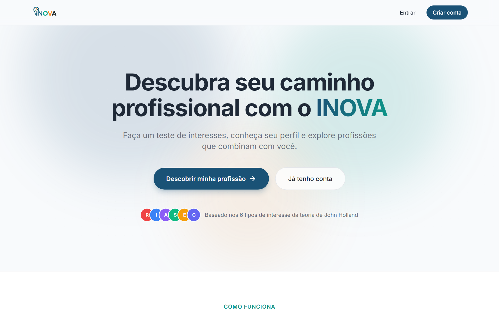
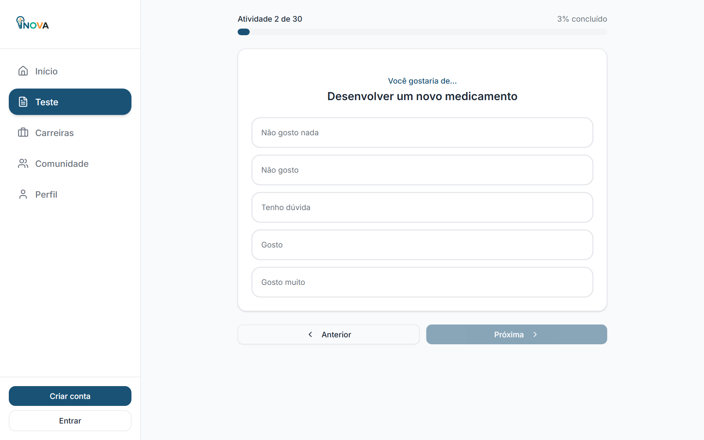
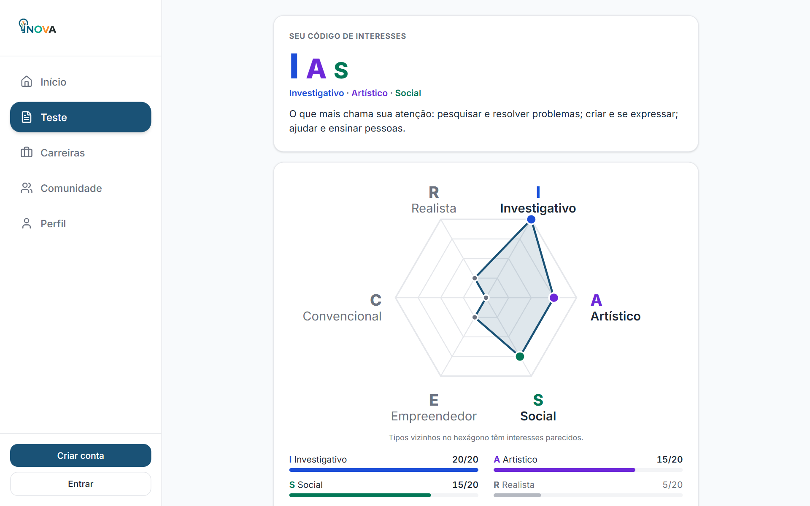
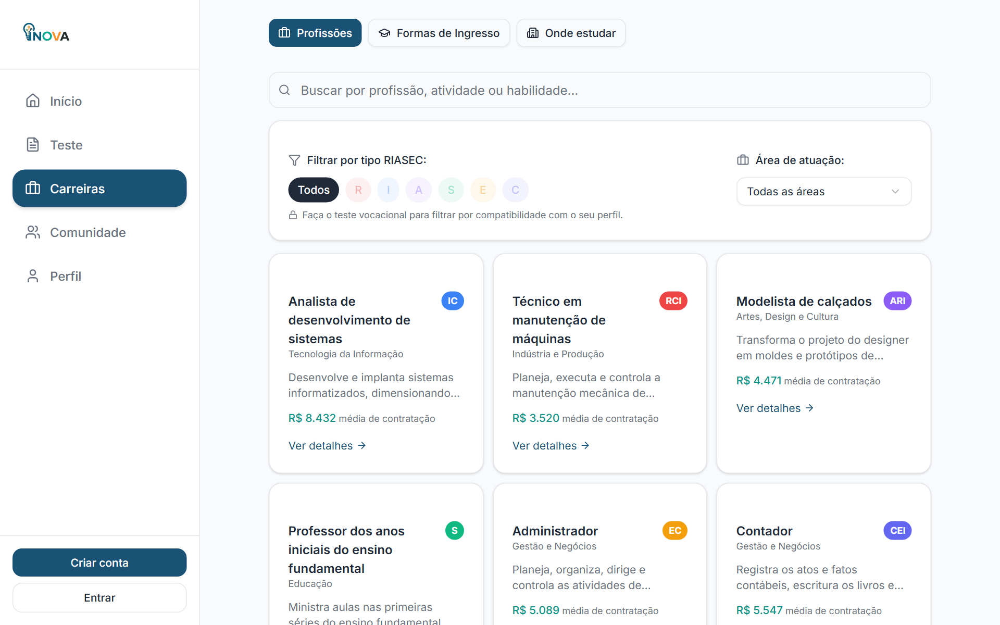
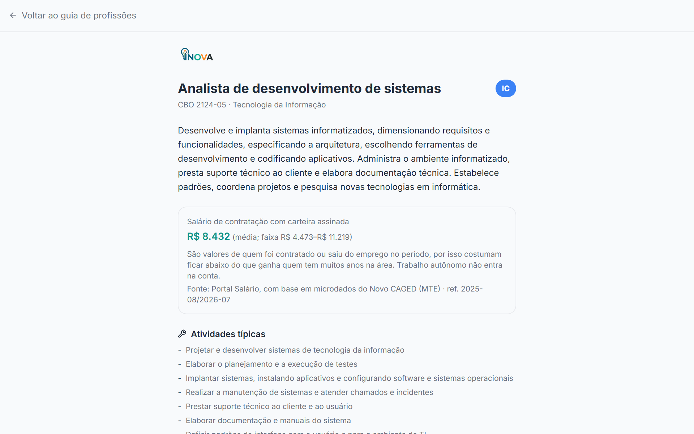
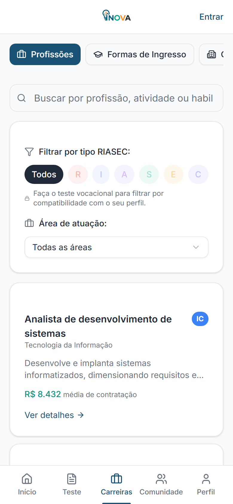

<p align="center">
  
</p>

<h1 align="center">INOVA — Plataforma de Apoio à Orientação Profissional</h1>

<p align="center">
  Trabalho de Conclusão de Curso de <strong>Sara Amabili Castilhos</strong> (Desenvolvimento Web)<br>
  <a href="https://inova-kappa.vercel.app"><strong>inova-kappa.vercel.app</strong></a>
</p>



## Sobre o projeto

O INOVA é um sistema web de apoio à orientação profissional, voltado principalmente a jovens do Ensino Médio e, secundariamente, a adultos em transição ou reorientação de carreira. Ele nasce de um problema concreto: a dificuldade de acesso a informações sobre profissões, somada à dificuldade de autoconhecimento na hora de decidir "o que seguir".

O objetivo é reduzir a indecisão e a ansiedade ligadas à escolha profissional, funcionando como **ferramenta complementar** — o INOVA não substitui a avaliação de um psicólogo ou orientador profissional habilitado.

## Telas

| Teste de interesses | Resultado |
| --- | --- |
|  |  |
| **Guia de profissões** | **Página de uma profissão** |
|  |  |

<p align="center">
  <br>
  <sub>O site também funciona no celular, com navegação pela barra inferior.</sub>
</p>

## Funcionalidades

- **Uso sem conta**: o visitante faz o teste e navega pelo guia sem se cadastrar. O resultado fica só no navegador e vai para a conta se a pessoa se cadastrar depois.
- **Cadastro e autenticação** por e-mail e senha, com recuperação de senha. O próprio usuário pode excluir a conta pelo perfil.
- **Teste de interesses RIASEC** (modelo de Holland — 6 tipos: Realista, Investigativo, Artístico, Social, Empreendedor, Convencional): adaptação pt-BR do **O\*NET Mini Interest Profiler** (30 itens, escala de 5 pontos). O resultado mostra o código de três letras, um hexágono com a pontuação de cada tipo e profissões para explorar; quem tem conta guarda o histórico de tentativas. Cada resultado registra a versão do questionário que o gerou.
- **Guia de carreiras**:
  - *Profissões* (80 fichas) com código CBO, descrição, atividades, habilidades, formação exigida, regulamentação, código RIASEC e salário de contratação com faixa (Novo CAGED), cada ficha com fontes públicas e data de acesso. Cada profissão tem uma página própria e pública em **/profissoes/[slug]**, com profissões parecidas e onde estudar na região. Busca textual e filtros por área de atuação e por tipo RIASEC (liberado após fazer o teste).
  - *Formas de ingresso* no ensino superior (ENEM, SISU, PROUNI, FIES, vestibular).
  - *Onde estudar*: instituições do Vale do Paranhana/RS e arredores, com os cursos oferecidos, se são gratuitas e como se entra.
  - Página pública **/metodologia** explicando as fontes do guia e o funcionamento do teste.
- **Comunidade**:
  - *Depoimentos* de profissionais, com curtidas e comentários. O autor pode editar o próprio depoimento e encerrar seus comentários.
  - *Fórum* de discussão com tópicos e respostas. O autor edita e fecha os próprios tópicos; o admin também fixa e modera qualquer conteúdo.
  - *Especialistas verificados*: quem atua ou já atuou na profissão do perfil (CBO) pede o selo com uma comprovação (link ou registro no conselho); a equipe aprova ou recusa com motivo. O selo identifica o especialista, mas não restringe quem responde no fórum.
  - *Moderação*: o conteúdo publica na hora (pós-moderação), passa por um filtro automático de termos ofensivos/spam no banco e pode ser denunciado para revisão.
- **Perfil**: foto, bio, contato, profissão da CBO (atua, estuda para ser ou já atuou), tempo de experiência, formação e perfil público (visível ao clicar no nome ou na foto de qualquer usuário).
- **Gamificação**: badges por marcos de uso (primeiro teste, primeiro depoimento, primeiro tópico etc.), sem ranking público.
- **Painel administrativo** (**/admin**, só para contas administradoras): denúncias, depoimentos ocultos, pedidos e revogação do selo de especialista e lista de termos bloqueados.

## Stack técnica

- **Framework:** Next.js 16 (App Router, Turbopack) + React 19 + TypeScript
- **UI:** Tailwind CSS 4 + shadcn/ui (Radix UI)
- **Backend/banco:** Supabase (PostgreSQL + Auth + Storage), acessado via `@supabase/ssr` — não há servidor Node.js próprio
- **Deploy:** Vercel

## Estrutura do projeto

```
app/            rotas (App Router): landing/app (a aba ativa fica em ?section=), autenticação,
                termos/privacidade, metodologia, profissoes/[slug] e admin (painel administrativo)
components/     seções do app (início, teste, carreiras, comunidade, perfil), admin/ (abas do
                painel) e ui/ (só os componentes shadcn/ui em uso — gere novos com `npx shadcn add <nome>`)
contexts/       AuthProvider — sessão, perfil, testes e badges do usuário logado; montado em
                app/layout.tsx para não reiniciar o login ao navegar entre páginas
data/           conteúdo curado e versionado: profissões, cursos, lista da CBO e instrumento do teste
lib/            tipos, carregamento do conteúdo de data/ e clientes Supabase
scripts/        validadores do conteúdo, conferência de links e geração da lista da CBO
banco/          schema.sql (estado atual completo do banco), migracoes/ (histórico numerado),
                dados/ (carga da CBO) e admin-helpers.sql (consultas de apoio)
docs/prints/    capturas de tela usadas neste README
```

## Como rodar localmente

Requer Node.js 20+ e um projeto Supabase.

1. `npm install`
2. Crie `.env.local` com `NEXT_PUBLIC_SUPABASE_URL` e `NEXT_PUBLIC_SUPABASE_ANON_KEY` do seu projeto.
3. `npm run dev` e abra <http://localhost:3000>.

## Banco de dados

- **`banco/schema.sql`** é a fonte da verdade: o estado atual completo do banco. Numa **instalação nova**, basta rodá-lo no SQL Editor do Supabase — ele já consolida todas as migrações. Depois, carregue a lista da CBO com `banco/dados/cbo-ocupacoes.sql`.
- **`banco/migracoes/`** guarda o histórico: cada mudança feita no banco de produção, numerada (`NNN-*.sql`), com o motivo explicado no cabeçalho. Num **banco existente**, aplique em ordem as que ainda não rodaram (todas são idempotentes). Toda mudança nova vira uma migração aqui **e** é consolidada no schema.
- `banco/admin-helpers.sql` não é migração: são consultas prontas para o que não tem tela no painel, como tornar uma conta administradora ou excluir uma conta a pedido.

## Conteúdo curado (guia e teste)

O guia de profissões, o catálogo de cursos e os itens do teste não ficam no banco: vivem em `data/` como JSON versionado no git. No guia, só as fichas com `status: "publicado"` aparecem para o usuário. Antes de commitar qualquer alteração de conteúdo:

```bash
npm run validate:professions   # regras e passo a passo em data/README.md
npm run validate:instruments   # regras e versionamento em data/instruments/README.md
npm run check:links            # confere se os links das fontes e dos cursos ainda funcionam
```

A lista de ocupações da CBO (`data/cbo.json` e `banco/dados/cbo-ocupacoes.sql`) é gerada a partir dos arquivos oficiais do Ministério do Trabalho com `node scripts/build-cbo.mjs` (instruções no próprio script).

O questionário é uma adaptação pt-BR **não oficial** do Mini Interest Profiler; os estudos de qualidade do instrumento (Rounds et al., 2016) são da versão original em inglês.

## Direitos autorais

© 2026 Sara Amabili Castilhos. Todos os direitos reservados.

O código está público para consulta e avaliação acadêmica. Nenhuma licença de uso, cópia, modificação ou distribuição é concedida sem autorização da autora.
